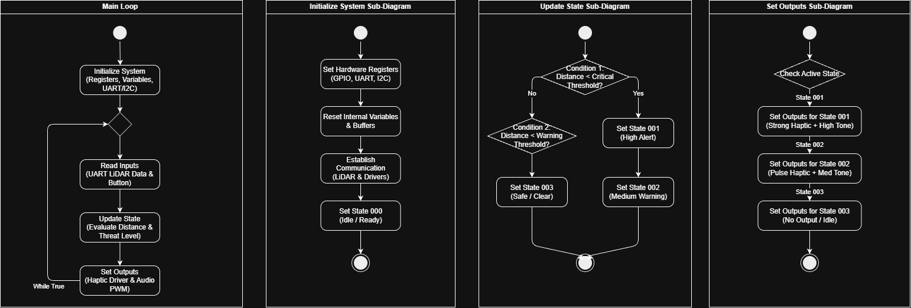

## Introduction
This page will go through our **software proposal** and all the results we had with our product 

## Research Question

* How can a compact, low-cost LiDAR sensor be designed to deliver reliable real-time depth perception for robotics and automated systems while maintaining commercial-grade 
* What hardware and software design choices most effectively reduce LiDAR production cost without sacrificing durability, accuracy, and ease of deployment?
* How does lowering the cost barrier of advanced 3D vision affect the adoption, efficiency, and competitiveness of smart automation solutions in commercial markets?

## Images

{style width:"350" height:"300;"}
**Figure 2:** Early PCB working design

**Figure 3:** Innovation Showcase Spring '25, where the products were a STEM-themed display that demonstrates a single scientific/engineering concept with the intended user of K-12 students interested in learning about science, technology, engineering, or math.

## Results

1. To be determined
1. To be determined
1. To be determined

## Conclusions and Future Work
To be determined
## External Links

[example link to idealab](https://idealab.asu.edu)

## Results

1. To be determined
1. To be determined
1. To be determined

## Conclusions and Future Work
To be determined 
## External Links

[example link to idealab](https://idealab.asu.edu)

## References

