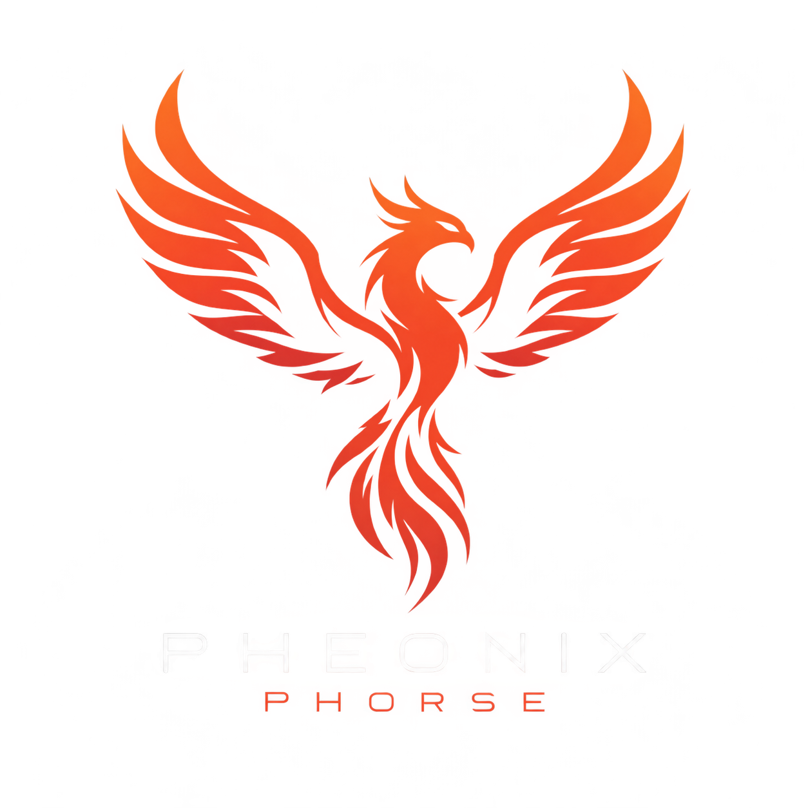

Project Phoenix Phorse 
Team 105 
Submission: 10/29/2026 
Fall 2026 
Arizona State University 
EGR 304 
Professor: Dr. Vivek Thangavelu 
  

## Team Introduction

Project Phoenix Phorse is focused on the development of a portable, rechargeable LiDAR (Light Detection and Ranging) system designed to enhance object detection and environmental awareness in robotic applications. The system utilizes a laser-based distance sensor mounted on a rotating mechanism to provide 360-degree scanning capabilities, allowing it to measure distances and detect surrounding obstacles with precision. An integrated buzzer or speaker provides audible alerts when objects are detected within a specified distance, helping users recognize nearby obstacles. The device is designed to be compact, energy-efficient, and adaptable, allowing robotics companies to incorporate the technology into their existing robotic platforms. Through this project, our team aims to develop a reliable and accessible sensing solution that improves obstacle detection, navigation, and overall operational safety in robotic systems.

## Team Members Datasheet links

|**Team Role**      | **Team Member**        |**Ind Datasheet Links** |
| ---------------------- | -----------------------| -----------------------|
| Team Leader /   | William Layja        |[link](https://williamlayja.github.io/wlayja_RAS304_F26/) |
| Handyman  | Khun Nyeinn Pyayt Oo   | [link](https://wanderer-annoy.github.io/khunoo_RAS304_F26/) |
| Intelligent Non-Organic Specialist  | Mohammed Al Rasbi      | [link](https://rasbi-m.github.io/malrasbi_RAS304_fall26/) |
| Researcher and Graphic Designer | Jose Baldenegro        | [link](https://jabalden-max.github.io/JaBalden_RAS304_F26/) |
| Co-Captain  | Isaiah Cruz            | [link](https://ras-embedded-systems.github.io/RAS304DataSheetTemplate/) |
